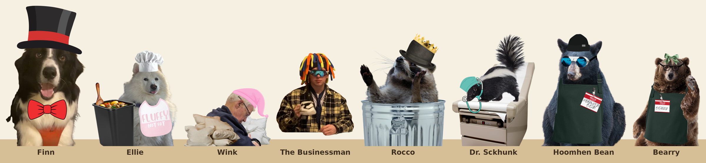

# Ranger stations

The station themes: what each one sells and how the shop works. Numbers in [brackets] are first guesses.

## How every station works

- **Which station:** each checkpoint gets a random theme that hasn't been used yet this run.
- **Always there, at every station:**
  - the free night's rest;
  - the rejoin service for an abandoned hiker;
  - the shopkeeper's "What's selling?" and "What's ahead?" talk;
  - the Workbench tab.
- **Fair for every theme:** a theme only changes *what* is for sale. Quality, prices and the market work the same way at every station, so no station is better than another.

### Stock each visit

- **Items:** 6 cards at the first station, and 1 more at each later station, up to 10.
  - [4] come from the station's focus and [2] can be anything.
  - Featured items are [3×] more likely.
  - Every item slot has an [8%] chance to be a trinket instead. No station focuses on trinkets, so every shop can sell them.
- **Blueprints:** 3, fitted to the theme:
  - Finn: clothes; Ellie: food; Wink: shelters; the Businessman: tools; Rocco: anything.
  - The newer stations below each say theirs.
- **Resource bundles:** [2].
- **Specials:** [1] random shared special (Cement Mixer, Taxi Service, Scout Report and so on).
- **Tiers by biome:** biome 1 is mostly Tier 1 with some Tier 2; biome 2 is mostly Tier 2; biome 3 is Tier 2 and 3.

### Quality

- Every shop item rolls a random Quality, the same way at every station.
- The roll favors the middle, with some high and some low: [10 / 20 / 40 / 20 / 10%] for Quality 1 / 2 / 3 / 4 / 5.
- Luck doesn't change shop Quality, so every visit is even.

### Prices

An item's price depends on its tier and Quality. Quality 1 costs half the Quality 3 price, Quality 2 costs ×0.75, Quality 4 ×1.25 and Quality 5 ×1.5 [first guess].

| Tier | Quality 1 | Quality 2 | Quality 3 | Quality 4 | Quality 5 |
| --- | --- | --- | --- | --- | --- |
| Tier 1 | 2 caps | 3 caps | 4 caps | 5 caps | 6 caps |
| Tier 2 | 4 caps | 6 caps | 8 caps | 10 caps | 12 caps |
| Tier 3 | 7 caps | 11 caps | 14 caps | 18 caps | 21 caps |

- **Blueprints:** 1.5× the item's Quality 3 price: 6 caps for Tier 1, 12 for Tier 2 and 21 for Tier 3.
- **A resource bundle** (3 resources): [4] caps.

### Selling

- **The market:** rolled fresh at every visit, whatever the theme.
  - [4] random resources sell for ×2, and [4] sell for ×0.5.
  - The rest sell at the normal price.
  - The "What's selling?" talk shows which ones.
- **Items:** half their price new (from the table), times how much is left.
  - "How much is left" means uses, bites or durability left, out of full.
  - Rounded down, and always at least 1 cap.
  - Shelters and trinkets sell for the full half.
  - Example: a Tier 2, Quality 4 jacket (new price 10) with 5 of 7 durability left sells for 10 ÷ 2 × 5/7 = 3 caps.

## The shopkeepers

Each shopkeeper's portrait, at the scale it's drawn, standing behind the counter.

## The stations

### Fancy Finn's Fashion Franchise (clothes)

- **Finn:** an excited mini Aussie who wiggles his butt whenever anyone walks in. He lives for attention and love, and every compliment makes him wiggle harder. "You came to MY shop?! *wiggle wiggle* Pets first, then shopping!"
- **Focus and blueprints:** clothes.
- **Featured:** Fancy Attire, Cozy Sweater, Flannel, Puffer Jacket, Rain Jacket, Heavy Jacket, Light-Up Skechers, Hiking Crocs, Disco Harness, Fanny Pack, all the socks, and Clothing Patches.

### Chef Bear's Garbage Grill (food)

- **Ellie, the Chef Bear:** a very loud Samoyed in a chef's hat who loves eating plastic and dirt, and can't understand why nobody else does. "WELCOME!!! TRY THE DIRT!!! IT'S FRESH TODAY!!!"
- **Focus and blueprints:** food.
- **Featured:** Hotlips Pizza Stick, Domino's Pizza, Rotisserie Chicken, Mystery Meat, Meatball Soup, Fish and Chips, Costco Sample, Old Spaghetti Factory, Dog Food, and Puked Nuggets (the only shop that sells them).

### Sleepy Wink's Pillow Fort (shelters)

- **Wink:** asleep, the whole time. He talks through his snores, and the shop mostly runs itself. "Zzz... welcome... zzz... tents in the back... zzzhonk..."
- **Focus and blueprints:** shelters.
- **Featured:** every shelter, especially Hammock, Tent, Cabin, Hostel and Yurt; plus Pajamas, Sleepy Socks, Camping Lamp, Coffee and, rarely, the Energy Serum.

### Serious Businessman's Sophisticated Selection (tools)

- **The Businessman:** very, very serious. He tells everyone, often, that he's a businessman, and insists on how serious he is. "I'm a businessman. This is serious business. I am being extremely serious right now."
- **Focus and blueprints:** tools.
- **Featured:** Swiss Army Knife, Telescope, Drone Camera, Security Camera, Radar Scanner, Walkie-Talkie, Paver, Wheelbarrow, Industrial Fertilizer, Planter.
- **Art:** his portrait comes with a second layer, just his resting arm, that goes in front of the counter.

### Rocco Raccoon's "Borrowed" Boutique (used and lost items)

- **Rocco:** the same Rocco from the Trials. A charming little thief who swears everything was "found." "It fell off a backpack. Totally legal."
- **Focus, the party's own stuff:** his items are ones the party used up or lost this run (eaten, broken, stolen at night, lost to Torn Pack, swept away and so on). Items the party sold don't count.
  - If fewer were used or lost than he has item slots, he stocks all of them, and the rest of the slots are random.
  - If more were, he picks the ones used or lost the fewest times. Ties are picked at random.
  - Each comes back as a fresh copy, with a new random Quality and full uses, bites or durability.
- **Blueprints:** 3 of anything.

### Rocco Raccoon's Random Resale (mystery items and bundles)

- **Rocco** again, with the same portrait, now running a mystery sale.
- **Mystery Items:** every item is face-down, of a random type and Quality. The card back shows only its tier. You see what it is once you buy it.
  - Each costs its tier's Quality 3 price, whatever is inside.
- **Blueprints:** 3 Mystery Blueprints, face-down the same way.
- **Bundles:** [4] instead of 2. Some can be resource packs (Forest, Wildlife, River, Mountain or any).

### Doctor Sckhunk's Support Service (medical)

- **Dr. Sckhunk:** a pediatrician skunk who treats every hiker like a nervous kid at a checkup. Gentle and calm, calls everyone "kiddo," and hands out stickers. Very, very sorry if anyone startles the doctor. "Okay, kiddo, say 'ahh.' Brave hiker! You get a sticker."
- **Focus and blueprints:** medical items, of any type.
- **Featured:**
  - Tools: Bandaid, Hello Kitty Bandaid, Bandages, Ointment, Healing Spray, Crutches, Medkit, Humidifier, Stuffed Animal.
  - Food: 7-Up, plus Hot Cocoa and Lemonade if they get built.
  - Clothes: Hardhat, Puffer Jacket, Harness.
  - Shelter: Medic Tent.

### BeaR E I (hiking gear)

- **Hoomhen Bean:** a bear in full hiking gear and a green apron, with a nametag that says "HOOMHEN BEAN." Definitely a regular human. Very worried about bears, and always warns the hikers to watch out for them. "Be careful out there, fellow hoomhens. Lotta bears around. Big ones. Not me, though."
- **Focus and blueprints:** hiking gear: shoes, packs, sticks and tents (anything on the featured list).
- **Featured:** Hiking Stick, Backpack, Fanny Pack, Rain Jacket, Flannel, Trail Shoes, Jogging Shoes, Hiking Crocs, Work Boots, Lifted Boots, Toe Shoes, Tent, Hammock, Binoculars, Supply Map, Camping Lamp, Trail Mix, Jerky, and Bear Spray (which he sells very nervously).

### Bearnes and Nobles (socks, XP and scouting)

- **Bearry:** a bookish bear with glasses and a green bow (his nametag says "BEARRY"), who whispers, shushes everyone and has a book to recommend for every problem. "Shh. Socks are in Fiction. Wisdom is in Nonfiction."
- **Focus and blueprints:** socks, XP items and scouting tools.
- **Featured:** Dog Socks, Cat Socks, Soup Socks, Sleepy Socks, Speedy Socks, Thinking Cap, VR Headset, Glasses, Scanner, Security Camera, Minesweeper, Linescan, Radar Scanner, Binoculars, Telescope.
- **Trinkets:** when an item slot turns into a trinket here, the Diploma, Textbook and Instruction Manual are [3×] more likely.

## Parked for later

Taken out for now, kept here in case you want them back:

- **Signature services:** Finn's Tailor (repair clothes), Ellie's Hot Meal, Wink's Deep Sleep, Rocco's Haggle, the Businessman's Investment.
- **Exclusive items:** Designer Scarf, Garbage Plate, Pillow Fort, Briefcase. (The Mystery Bag is now the Random Resale.)
- Rocco's 10% off for each Rocco Trial finished.

## More theme ideas

- **Stormy's Weather Shack** (weather gear): Rain Jacket, Umbrella, Sunscreen, Hand Warmers, Snowshoes, Wool Beanie, Sun Hat.
- **Trail Taxi Depot** (moving): Trampoline, Paver, Roller Skates, Rope, and the moving specials (Cement Mixer, Taxi Service) always in stock.
- **Pawsome Pet Supply** (families): Dog Food, Dog Socks, Cat Socks, Harness, the Ring.
- **Snake Eyes Casino** (gambling): tied to the Snake Salesman and Snake Slots opportunities, with double-or-nothing on sales.

## Decided

- Both Rocco shops can show up in the same run. They count as two separate themes.
- Items the party sold don't count as lost for Rocco's Boutique.
- Later stations get 1 more item each, up to 10.
